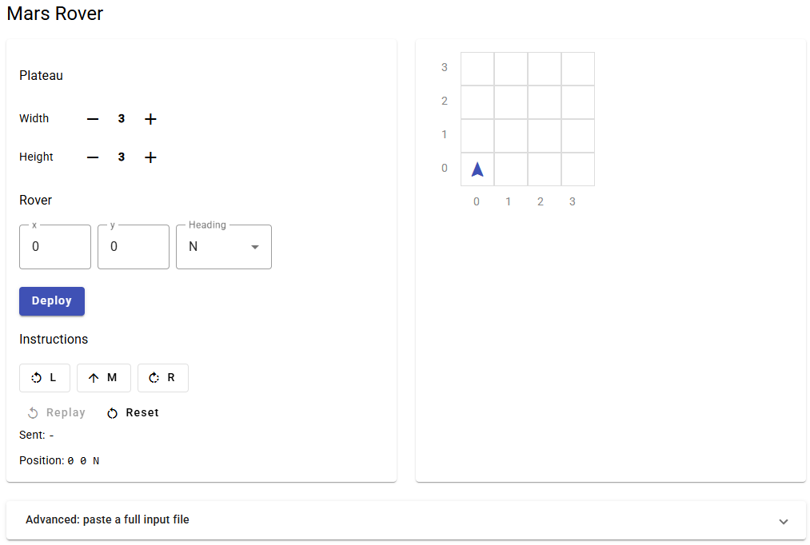

# Mars Rover

A squad of robotic rovers are to be landed by NASA on a plateau on Mars.
The rovers navigate the plateau so their on-board cameras can get a complete
view of the surrounding terrain.

## Rules

- The plateau is divided up into a grid, lower-left co-ordinates are `0 0`.
- A rover's position is `x y` co-ordinates + a heading (`N`, `E`, `S`, `W`).
- Instructions:
  - `L` / `R` : spin 90 degrees left / right, without moving
  - `M` : move forward one grid point, same heading
- The square directly North from `(x, y)` is `(x, y+1)`.
- Rovers are finished sequentially: the second one starts once the first one is done.

## Input

```
5 5
1 2 N
LMLMLMLMM
3 3 E
MMRMMRMRRM
```

- line 1 : upper-right co-ordinates of the plateau
- then 2 lines per rover : position, then instructions

## Output

Final co-ordinates and heading of each rover:

```
1 3 N
5 1 E
```

## Requirements

- Java 11+
- Maven 3

## Build

```
mvn clean verify
```

Runs the tests and builds `target/rover.jar`.

## Code coverage

JaCoCo runs during `mvn verify`, the report is in `target/site/jacoco/index.html`.

## Run

```
java -jar target/rover.jar input.txt
```

## Project structure

```
src/main/java/com/lilakanoun/marsrover
├── Application.java     reads the input file and prints the result
├── MissionRunner.java   runs the rovers one after the other
├── domain/              Heading, Instruction, Position, Plateau, Rover
└── parser/              InputParser

api/                     REST API (Spring Boot), uses mars-rover as a lib
front/                   Angular front
docs/                    screenshots
```

## REST API

Separate Maven project in `api/`. Install the core jar first, then build the API:

```
mvn clean install
cd api
mvn clean verify
java -jar target/rover-api.jar
```

`POST /missions` takes the input file as plain text:

```
curl -X POST http://localhost:8081/missions -H "Content-Type: text/plain" --data-binary @input.txt
```

```json
{
  "plateau": { "upperRightX": 5, "upperRightY": 5 },
  "rovers": [
    { "x": 1, "y": 3, "heading": "N" },
    { "x": 5, "y": 1, "heading": "E" }
  ]
}
```

An unknown instruction or heading returns `400 Bad Request`.

Swagger UI: http://localhost:8081/swagger-ui.html

## Front

Angular 15 + Angular Material app in `front/`, needs Node 18. Start the API first, then:

```
cd front
npm install
npx ng serve
```

Open http://localhost:4200:



- **Plateau**: `+` / `-` to change the size
- **Rover**: set `x`, `y`, heading, then **Deploy**
- **Instructions**: `L`, `M`, `R` move the rover live, each click calls the API
- **Replay**: plays the instructions again step by step, **Reset**: back to the start position
- **Advanced**: paste a full input file and **Run** it

The statement says nothing about the plateau edges: the front disables `M` when the rover would leave the plateau.

Calls to `/missions` are proxied to the API on port 8081 (`proxy.conf.json`).

## Docker

Runs the API and the front, no Java or Node needed:

```
docker compose up --build
```

| Service | URL |
|---|---|
| Front | http://localhost:4200 |
| API | http://localhost:8081/missions |
| Swagger UI | http://localhost:8081/swagger-ui.html |

- `api/Dockerfile`: builds the core jar then the API with Maven, runs it on a Java 11 JRE (Eclipse Temurin, Alpine)
- `front/Dockerfile`: builds the Angular app with Node 18, serves it with nginx
- `front/nginx.conf`: proxies `/missions` to the `api` container
- the front starts once the API is healthy (`/actuator/health`)

Stop with `docker compose down`.

## CI

`Jenkinsfile` stages:

| Stage | Steps |
|---|---|
| Test | Core tests, API tests: blocking, a failing test stops the pipeline |
| Build | Core, API, Front |
| Docker | api and front images: syntax check, build, deploy to Artifactory |
| Internal tools | Sonar, Fortify, Nexus |
